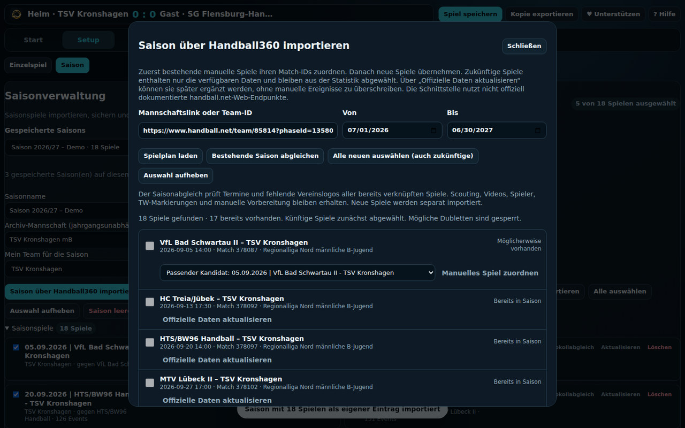
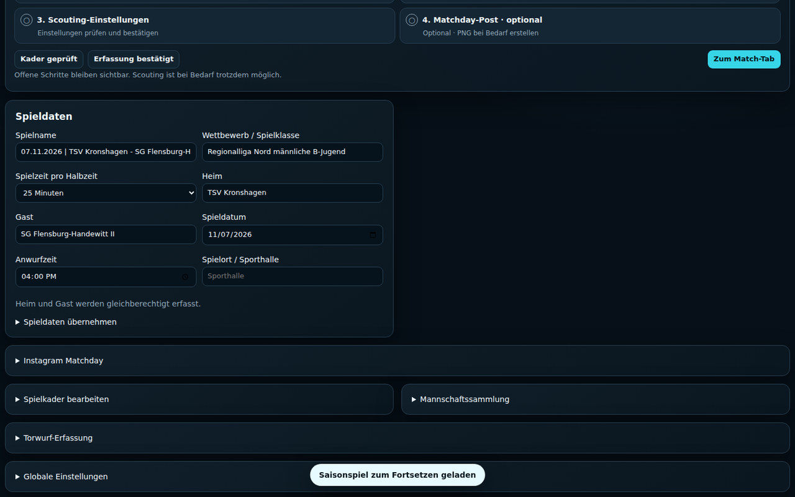
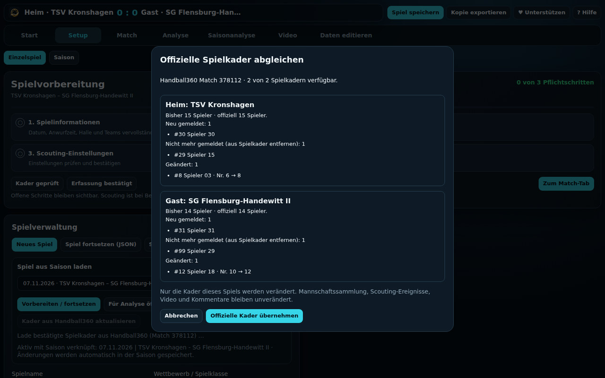
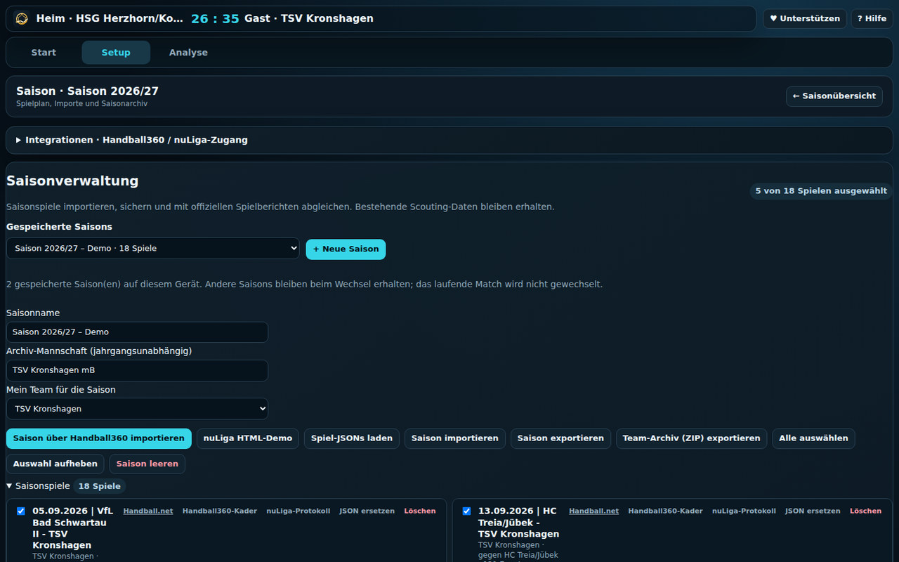
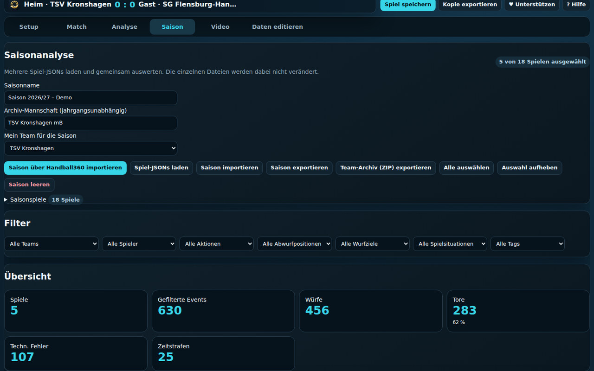

# Vom Einzelspiel zur gesamten Saison

Die Spielanalyse unterstützt zwei organisatorische Einstiege. Die eigentliche Ereigniserfassung erfolgt anschließend in denselben drei Workflows [W1 (Live), W2 (Live + Video) und W3 (Video)](workflows.md).

## Welcher Einstieg ist richtig?

| Situation | Einstieg | Speicherung |
|---|---|---|
| Einzelne Begegnung ohne Saisonverknüpfung | **Setup → Neues Spiel** oder **Spiel laden (JSON)** | Eigenständige Spiel-JSON; **Spiel speichern** aktualisiert die geöffnete Datei, sofern der Browser dies ermöglicht, oder bietet einen Download |
| Begegnung der verwalteten Saison | **Setup → Spiel aus Saison laden** | Änderungen werden unter der bestehenden Saisonspiel-ID lokal im Saisonarchiv aktualisiert; **Spiel speichern** sichert diesen Datensatz |
| Nachanalyse einer Saisonbegegnung | **Setup → Spiel aus Saison laden → Für Analyse öffnen** | Dieselbe Saisonbegegnung, keine zusätzliche Kopie |
| Dateien zur Archivierung/Übertragung | **Saison → Saison exportieren** oder **Team-Archiv (ZIP) exportieren** | Exportierte Momentaufnahme; kein automatischer Abgleich mit früher heruntergeladenen Dateien |

## Eine Saison erstmals einrichten



1. **Saison** öffnen und **Saison über Handball360 importieren** wählen.
2. Mannschaftslink eingeben, z. B. [Team 85814, Phase 13580](https://www.handball.net/team/85814?phaseId=13580), und Saisonzeitraum prüfen.
3. Über **Spielplan laden** die Begegnungen abrufen. Der Import zeigt zu jeder Begegnung Datum, Mannschaften und Status.
4. **Bereits manuell erfasste Spiele zuerst zuordnen.** Bei **Möglicherweise vorhanden** das richtige vorhandene Spiel wählen und **Manuelles Spiel zuordnen** bestätigen. Dadurch bleibt das ursprüngliche Scouting erhalten und erhält seine offizielle Match-ID.
5. Erst anschließend **Alle neuen auswählen (auch zukünftige)** und **Ausgewählte Spiele importieren**. Die noch nicht gespielten Partien bleiben ohne Ereignisse und sind zunächst aus der Saisonstatistik abgewählt.
6. **Mein Team für die Saison** und **Archiv-Mannschaft** prüfen. Die dauerhaft verwendete Archiv-Mannschaft bestimmt den obersten Ordner des ZIP-Exports, nicht die jährlich wechselnde Handball360-Team-ID.

**Achtung:** Handball360 liefert nicht alle handballspezifischen Auswertungen der Spielanalyse. Insbesondere Wurfpositionen, Wurfziele und vollständige Torhüterstatistiken können aus reinen offiziellen Ereignissen fehlen. Bereits selbst gescoutete Ereignisse werden bei der offiziellen Aktualisierung nicht ungefragt ersetzt.

## Ein Saisonspiel im Setup vorbereiten



[Smartphoneansicht](images/generated/setup-season-game-mobile.jpg)

1. Im **Setup** unter **Spiel aus Saison laden** die gewünschte Begegnung auswählen.
2. Bei noch nicht begonnenen Spielen **Vorbereiten / fortsetzen** nutzen. Bei bereits importierten offiziellen oder Videoereignissen **Für Analyse öffnen** wählen.
3. Heim/Gast, Spielzeit und Trikotnummern kontrollieren. Kader sind für jedes Spiel einzeln gespeichert.
4. Für den Spieltag etwa 30 Minuten vor Anpfiff die aktuellen Meldungen aus Handball360 abrufen (nächster Abschnitt).
5. Anschließend im **Match**-Tab W1, W2 oder W3 durchführen. Für Live-Scouting **unbedingt vor dem ersten Event zuerst Realzeit starten, dann Spielzeit starten**.

**Wichtig:** Das aus der Saison geöffnete Spiel bleibt mit dem Saison-Datensatz verknüpft. Eigene Änderungen sollen nicht zusätzlich über einen unabhängigen JSON-Import in die Saison eingefügt werden; das könnte eine zweite Version erzeugen.

## Kurz vor Anpfiff: bestätigte Spielkader übernehmen



[Smartphoneansicht](images/generated/setup-lineup-review-mobile.jpg)

1. Saisonbegegnung im Setup auswählen und **Kader aus Handball360 aktualisieren** drücken.
2. Der Dialog zeigt für Heim und Gast neue Spieler, nicht mehr gemeldete Spieler und Änderungen etwa an Trikotnummern.
3. **Offizielle Kader übernehmen** bestätigt die Aktualisierung. Über **Abbrechen** bleibt alles wie bisher.
4. Fehlende offizielle Aufstellungen ersetzen vorhandene Kader **nicht**. Ein erneut ausgeführter Abruf ist möglich, sobald die Meldung vorliegt.
5. **Nach bereits erfassten Scouting-Ereignissen ist die automatische Kaderersetzung gesperrt**, um Spielerreferenzen in den Events nicht zu beschädigen.

Der Kadervergleich ändert nur den jeweiligen Spielkader, nicht die globale Mannschaftssammlung. Ein bereits geöffnetes und mit der Saison verbundenes Spiel wird ebenfalls synchronisiert.

## Saison auswerten und sichern



[Smartphoneansicht](images/generated/season-overview-mobile.jpg)

Die **Saisonanalyse** berücksichtigt nur die ausdrücklich ausgewählten Spiele. Künftige Begegnungen mit leerer Ereignisliste zählen daher nicht mit. Die Filter ermöglichen Team-, Spieler- und Ereignisauswertungen über mehrere Spiele.



**Sicherung:** Über **Saison exportieren** entsteht eine JSON-Datei mit der aktuellen Saison. Über **Team-Archiv (ZIP) exportieren** entsteht zusätzlich eine Ordnerstruktur mit einer vollständigen `spiel.json` pro Begegnung:

```text
TSV_Kronshagen_mB/
├── TSV_Kronshagen_vs_SG_Flensburg-Handewitt_II_378112/
│   ├── spiel.json
│   ├── videos/
│   └── exports/
└── Saison_2026_27_index.json
```

Auch **manuell erfasste und später zugeordnete Spiele** werden in dieses ZIP aufgenommen. Videoverweise und Zeichnungsdaten sind Teil der Spiel-JSON, aber die eigentlichen MP4-Videos werden **noch nicht** ins ZIP eingebettet. Das ZIP ist eine Momentaufnahme: Nach weiteren Änderungen muss es erneut exportiert werden.

## Hinweise zu den Screenshots

Die Screenshots stammen aus der **echten Spielanalyse-PWA** (Playwright/Chromium). Als Grundlage dienen die 18 Spieltermine, Begegnungen und Match-IDs der Saison 2026/27. **Alle dargestellten Spieler und alle Ereignis-/Statistikwerte sind anonymisierte Demo-Daten**, nicht die personenbezogenen Scouting-Daten des Vereins. Der Handball360-Spielplan und der Kaderabruf werden bei der automatischen Aufnahme simuliert; hierfür ist kein Live-Abruf öffentlicher Schnittstellen erforderlich. Auf iPhone/iPad können Datei- und Speicherdialoge anders aussehen.
