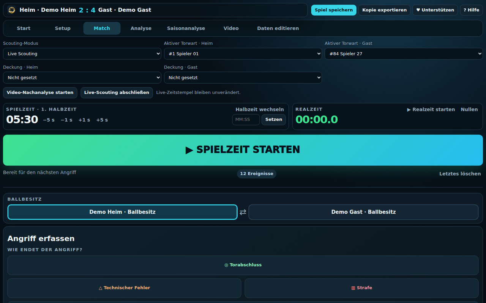
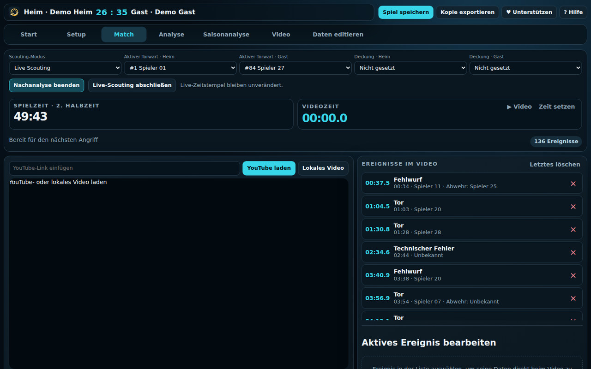
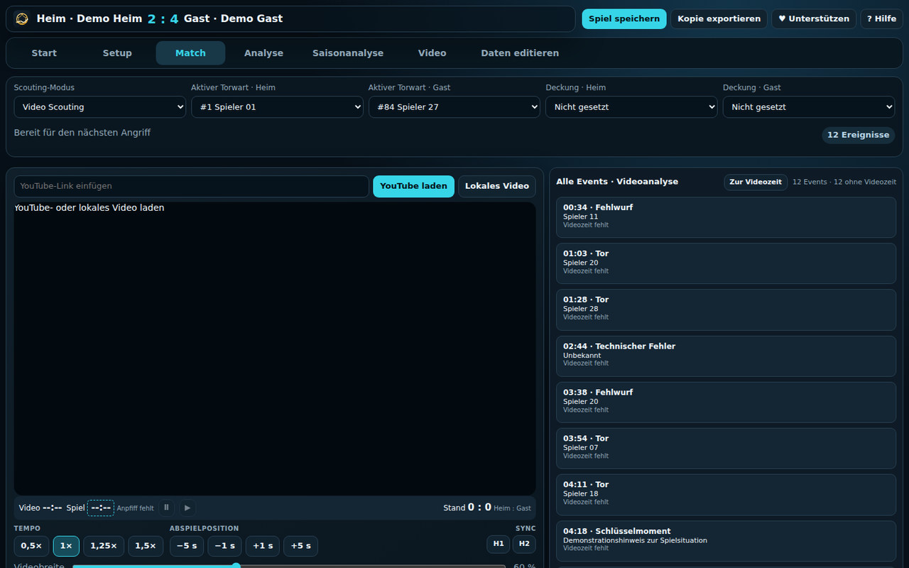

# Die drei Scouting-Arbeitsabläufe

**Vor dem Scouting:** Zuerst entscheiden, ob es sich um ein [eigenständiges Einzelspiel oder ein Saisonspiel](saison-workflow.md) handelt. Bei einem Saisonspiel erfolgt die Auswahl im Setup. Dort können kurz vor dem Anpfiff die offiziellen Handball360-Kader aktualisiert werden. W1–W3 gelten für beide Einstiege.

## Vor dem Start: Entscheidung

1. **Ereignisse entstehen während des Spiels?** → W1 oder W2.
2. **Eine spätere Videoüberprüfung ist geplant?** → W2.
3. **Ein Video ist schon vorhanden und Ereignisse müssen erst erfasst werden?** → W3.

> Die Auswahl **Scouting-Modus** befindet sich im **Match-Tab** und bietet **Live Scouting** oder **Video Scouting**. Der Code verhindert den Wechsel dieses Grundmodus, sobald Ereignisse erfasst wurden. Eine spätere **Video-Nachanalyse** der Live-Ereignisse ist eine eigene Funktion, kein Umschalten auf Video Scouting.

## W1 – Ausschließlich Live Scouting

[Ansicht auf dem Smartphone](images/generated/w1-live-mobile.jpg) · [Spielanlage im Setup](images/generated/setup-desktop.jpg)

**Zweck:** Während des Spiels Ereignisse erfassen und anschließend eine unmittelbare Auswertung erhalten.

**Bildschirm:** Im Live-Modus bleiben **Video und Eventliste ausgeblendet**, damit die Ereigniserfassung die volle Breite nutzt. Wenn der Hallensprecher die Torschützen erst nach dem Abschluss nennt, kann im **Setup → Torwurf-Erfassung** die Option **Schütze zuletzt** aktiviert werden. Dann werden zunächst Wurfdetails und Ergebnis erfasst; der Schütze wird am Ende gewählt, ohne den ursprünglichen Zeitstempel zu verändern. Ein falsch erfasstes letztes Event kannst du direkt über **Letztes löschen** entfernen. Die Video-Nachanalyse blendet Video und Ereignisliste bei Bedarf wieder ein.

**Voraussetzungen:** Spiel eingerichtet, Heim-/Gastmannschaft und möglichst Kader korrekt eingetragen; im Match-Tab stehen die unabhängigen Uhren **Realzeit** und **Spielzeit** zur Verfügung.

> **Unbedingt vor dem ersten Ereignis:** Im Match-Tab auf **`▶ Realzeit starten`** tippen und kontrollieren, ob sie läuft. Erst danach **`▶ SPIELZEIT STARTEN`** drücken. Die Realzeit liefert den Zeitbezug der Live-Ereignisse, der für eine spätere Zuordnung zum Video benötigt wird. Die Spielzeit allein reicht dafür nicht aus.

### Ablauf
1. **Setup:** `Neues Spiel` wählen oder über **Spiel aus Saison laden** die Begegnung auswählen und **Vorbereiten / fortsetzen** nutzen. Paarung und Spieler kontrollieren. Vor dem ersten Event prüfen, ob Heim/Gast korrekt zugeordnet sind.
2. **Match:** `Scouting-Modus → Live Scouting` wählen, falls noch nicht aktiv.
3. **Vor Anpfiff – zuerst Realzeit:** Unter **Realzeit** auf `▶ Realzeit starten` tippen und die laufende Anzeige kontrollieren. Halbzeit, Spielzeit, aktiven Torwart und Abwehrzuordnung prüfen.
4. **Bei Anpfiff – danach Spielzeit:** `▶ SPIELZEIT STARTEN` betätigen und erst jetzt Ereignisse erfassen. Die App verlangt beim Start der Spielzeit im Live-Modus eine laufende Realzeit.
5. **Während des Spiels:** Ereignisse über den Eventfluss im Match-Tab erfassen; Folgeangaben (z. B. Spieler, Wurfbereich/Ziel, Ausgang, Spielsituation) nach tatsächlich beobachteten Fakten setzen.
6. **Unterbrechung/Halbzeit:** **Spielzeit** pausieren und Halbzeit wechseln. **Realzeit nicht zusammen mit der Spielzeit stoppen oder nullen:** Sie soll weiterlaufen, solange die zugehörige Videoaufnahme eine durchgehende Zeitachse hat. Bei unterbrochenen/geschnittenen Aufnahmen muss der Videozeitbezug später entsprechend geprüft werden.
7. **Nach Abpfiff:** Events auf Vollständigkeit, Spielstand und Realzeitbezug prüfen; `Analyse` öffnen.
8. **Sichern:** `Spiel speichern` oder `Kopie exportieren` nutzen. Bei verknüpften Saisonspielen wird der Saison-Datensatz aktualisiert; bei unabhängigen Dateien hängt die Speicherung vom Browser ab.

**Ergebnis:** Ereignisse mit Spielzeit, Mannschafts-/Spielerbezug und auswertbaren Details. Kein Video erforderlich.

**Qualitätskontrolle:** Spielstand und erfasste Torfolge plausibel? Spielzeit korrekt? Fehlende Aktionen oder falsch zugeordnete Spieler nachbearbeiten.

**Grenze:** Was live nicht sicher beobachtet wurde, nicht spekulativ nachtragen.

## W2 – Live Scouting und spätere Video-Nachanalyse

[Ansicht auf dem Smartphone](images/generated/w2-review-mobile.jpg) · *Aufnahme ohne echtes Video: Spieler- und Ereignisdaten stammen aus pseudonymisierten Demo-Fixtures.*

**Zweck:** Live die wesentlichen Events erfassen, anschließend über ein aufgezeichnetes Video kontrollieren, präzisieren und für Coaching-/Clip-Arbeit nutzen.

### Teil A – Live vor Ort

> **Voraussetzung für die spätere Video-Nachanalyse:** Unbedingt **vor dem ersten Event die Realzeit starten** und erst danach die Spielzeit. Werden Live-Ereignisse ohne korrekt laufende Realzeit erfasst oder wird die Realzeit zwischenzeitlich unpassend zurückgesetzt, fehlen verlässliche Zeitbezüge zum nachträglich geladenen Video. H1/H2-Sync allein kann die Zeitinformation verlorener beziehungsweise fehlerhafter Realzeitstempel nicht vollständig ersetzen.

1. Spiel wie in **W1** einrichten; **Realzeit starten → Spielzeit starten → Events erfassen**.
2. Während Spielunterbrechungen die **Spieluhr** pausieren, die **Realzeit** bei durchgehendem Video weiterlaufen lassen; bei Halbzeitwechsel die Zeitbezüge kontrollieren.
3. Ergebnis, Events und Realzeitbezug prüfen, anschließend die Spiel-JSON sichern.
4. Optional: Video separat aufnehmen oder später beziehen, z. B. als heruntergeladene Sportlounge-MP4.

### Teil B – Nach dem Spiel mit Video
5. **Setup:** Gesicherte Spieldatei laden bzw. Spiel fortsetzen; bei einer Saison über **Spiel aus Saison laden → Für Analyse öffnen** auswählen.
6. **Match:** Video über `Lokales Video` oder einen unterstützten YouTube-Link laden.
7. **Match:** `Video-Nachanalyse starten` benutzen. Die bereits erfassten Live-Zeitstempel bleiben dabei unverändert.
8. **Synchronisieren:** Video auf den Anpfiff H1 setzen, **H1** markieren; für H2 wiederholen. Gegebenenfalls Korrektur der Video-/Spielzeit vornehmen.
9. **Ereignisse durchgehen:** Eventliste nutzen und an passende Videoabschnitte springen. Im Event-Detail fehlerhafte oder fehlende Angaben korrigieren. Bei neuen Events beachten, ob die Zeit aus dem Video und/oder der Spielzeit übernommen wird.
10. **Coaching:** Im Event-Kontext Zeichnungen ergänzen, auf Sichtbarkeit und Startzeit achten; aus dem Video-Tab gefilterte Szenen/Clips vorbereiten.
11. **Speichern:** Aktualisierte Spieldatei erneut sichern und ggf. Clips separat exportieren.

**Ergebnis:** Konsolidierte Live-Events mit geprüften Videobezügen und optionalen Zeichnungen/Clips.

**Qualitätskontrolle:** Waren bei der Live-Erfassung die Realzeit und die Spielzeit korrekt gestartet? Sind Realzeitbezüge an Events vorhanden und plausibel? Stimmen H1 und H2? Springen Events zur richtigen Szene? Ist der Clip-Vorlauf berücksichtigt? Wurde nur verändert, was im Video überprüfbar ist?

**Grenze:** Nur H1/H2 reichen nicht aus, reale Unterbrechungen sekundengenau abzubilden. Videozeit und Spielzeit können zwischen den Synchronisationspunkten auseinanderlaufen.

## W3 – Ausschließlich Video Scouting

[Ansicht auf dem Smartphone](images/generated/w3-video-mobile.jpg) · *Vorläufig ohne MP4; der schwarze/leere Player ist bei dieser Demoversion erwartet.*

**Zweck:** Ein vorhandenes Spielvideo nachträglich analysieren, ohne während des Spiels gescoutet zu haben.

**Voraussetzung:** Lokale Videodatei (z. B. Sportlounge-MP4) oder unterstützter YouTube-Link; Teams im Setup angelegt. Kader können nachgetragen werden.

### Ablauf
1. **Setup:** Neues Spiel anlegen, Heim-/Gast-Team korrekt festlegen, vorhandene Kader importieren oder manuell eintragen.
2. **Match:** Noch **vor der ersten Ereigniserfassung** den Modus `Video Scouting` wählen.
3. **Video laden:** `Lokales Video` oder `YouTube laden` nutzen. Die Video-Datei ist eine separate Quelle und nicht die Spiel-JSON.
4. **Video und Spielzeit zuordnen:** Wenn Spielzeitanzeige benötigt wird, Startpositionen von H1 und H2 synchronisieren. Video bei Bedarf pausieren oder verlangsamen.
5. **Ereignisse erfassen:** Mit dem Video an die relevante Szene gehen; das neue Event im Match-Tab erzeugen und beobachtbare Details zuordnen. Ereignisse entlang der Videoposition überprüfen.
6. **Szenen prüfen:** Events auswählen, ihre Daten bearbeiten, Zeichnungen ggf. im Event-Kontext anlegen.
7. **Auswerten:** `Analyse` und ggf. `Video` für Filterung und Clips nutzen.
8. **Sichern:** Spiel-JSON speichern/exportieren; erzeugte Clips gesondert sichern.

**Ergebnis:** Eine Eventanalyse, deren primärer zeitlicher Bezug vom Video stammt.

**Qualitätskontrolle:** Sind sämtliche Ereignisse dem richtigen Team/Spieler zugeordnet? Entspricht die Chronologie dem Video? Sind Spielzeitfelder nur dort gesetzt, wo sie zuverlässig ableitbar sind?

**Grenze:** Ohne echte Spielzeit-Synchronisation darf eine Videozeit nicht stillschweigend als Spielzeit gelten. Ohne Sicht auf den entsprechenden Abschluss nicht zwischen Parade, Block und Fehlwurf raten.

## Gemeinsames Abschlussprotokoll

| Prüffrage | W1 | W2 | W3 |
|---|---|---|---|
| Heim/Gast und Spieler richtig? | Pflicht | Pflicht | Pflicht |
| Spielstand / Ereignisse plausibel? | Pflicht | Pflicht | Pflicht |
| Uhrzeit/Spielzeit geprüft? | Pflicht | Pflicht | Bei Zuordnung |
| Video geladen? | Nein | Ja | Ja |
| H1/H2-Sync getestet? | Nein | Ja | Wenn benötigt |
| Zeichnungen/Clips überprüft? | Optional | Optional | Optional |
| Spiel-JSON gesichert? | Pflicht | Pflicht | Pflicht |

**Hinweis zu Sportlounge:** Video innerhalb zulässiger Nutzungsrechte herunterladen und über die lokale Videoauswahl öffnen. Eine direkte Sportlounge-Player-Anbindung ist nicht Bestandteil dieses Workflows.
